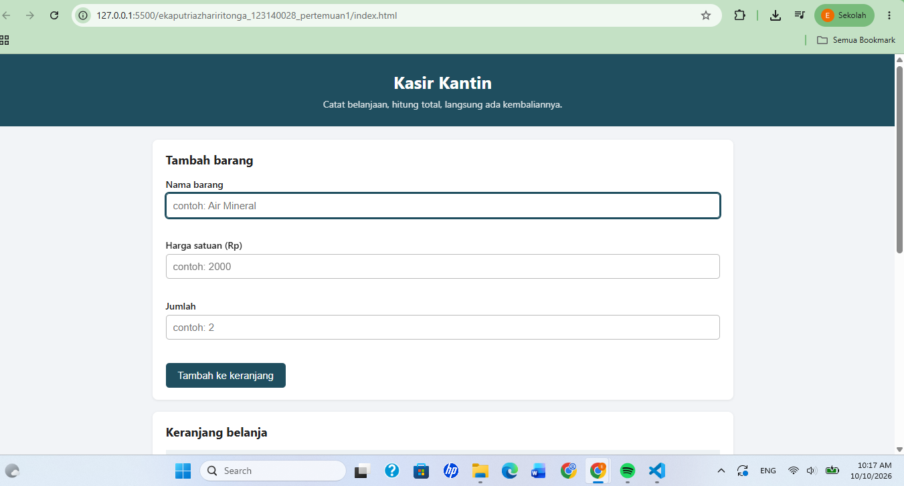
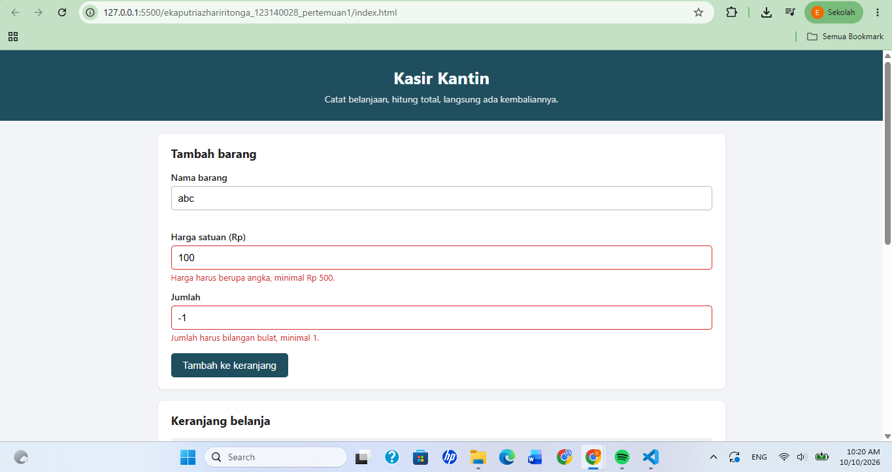
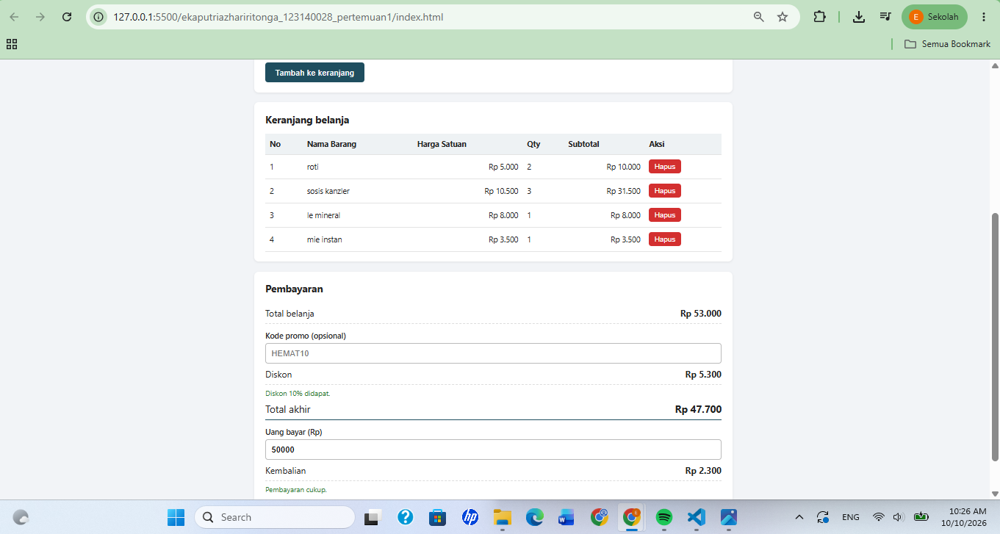

# Kasir Kantin (Mini POS)

Nama: Eka Putri Azhari Ritonga
NIM: 123140028
Kelas Praktikum: RA

## Deskripsi Aplikasi

Aplikasi ini adalah kasir dan keranjang belanja sederhana untuk kantin kampus. Kasir memasukkan barang yang dibeli pelanggan (nama, harga satuan, dan jumlah), lalu aplikasi menghitung subtotal, total belanja, diskon, dan kembalian secara otomatis. Studi kasus yang dipilih adalah kasir kantin kampus.

Tujuannya agar proses pencatatan dan penghitungan belanja tidak perlu dilakukan manual. Isi keranjang disimpan di localStorage sehingga tidak hilang ketika halaman di-refresh.

## Cara Menjalankan

Buka folder `ekaputriazhariritonga_123140028_pertemuan1` di VS Code, lalu jalankan `index.html` dengan Live Server (klik kanan pada file, pilih Open with Live Server). File tersebut juga bisa langsung dibuka di browser.

## Daftar Fitur

- [x] Validasi nama barang (minimal 3 karakter)
- [x] Validasi harga satuan (angka, minimal Rp 500)
- [x] Validasi jumlah (bilangan bulat, minimal 1)
- [x] Pesan error berwarna merah di bawah input yang salah
- [x] Form otomatis di-reset setelah barang berhasil ditambahkan
- [x] Perhitungan subtotal per baris dan total belanja
- [x] Diskon 10% jika total minimal Rp 50.000 atau memakai kode `HEMAT10`
- [x] Input uang bayar dan perhitungan kembalian, dengan keterangan jika uang kurang
- [x] Tabel keranjang belanja (No, Nama Barang, Harga Satuan, Qty, Subtotal, Aksi)
- [x] Tombol hapus per baris, total dihitung ulang otomatis
- [x] Penyimpanan data dengan localStorage
- [x] Tombol transaksi baru untuk mengosongkan keranjang

## Screenshot Hasil

Tampilan form input utama:

Tampilan saat validasi error muncul:

Tampilan hasil perhitungan dan tabel keranjang:

## Penjelasan Teknis Singkat

**Validasi input.** Saat form di-submit, fungsi `validasi()` memeriksa ketiga input satu per satu. Jika ada yang tidak sesuai aturan, pesan error ditampilkan di bawah input tersebut dan barang tidak ditambahkan ke keranjang. Untuk jumlah digunakan `Number.isInteger()` agar angka desimal ditolak.

**Perhitungan.** Keranjang disimpan dalam array yang berisi object `{ nama, harga, qty }`. Total didapat dengan melakukan loop pada semua item lalu menjumlahkan `harga * qty`. Diskon 10% diberikan jika total mencapai Rp 50.000 atau kode promo `HEMAT10` diisi. Total akhir adalah total dikurangi diskon, dan kembalian adalah uang bayar dikurangi total akhir. Setiap data berubah, fungsi `render()` dipanggil untuk menampilkan ulang tabel dan hasil hitungan.

**localStorage.** Setiap kali keranjang berubah (tambah atau hapus), array diubah menjadi string dengan `JSON.stringify()` lalu disimpan. Saat halaman dimuat, data diambil kembali dan diubah menjadi array dengan `JSON.parse()`. Tombol transaksi baru menghapus data tersebut dengan `localStorage.removeItem()`.
