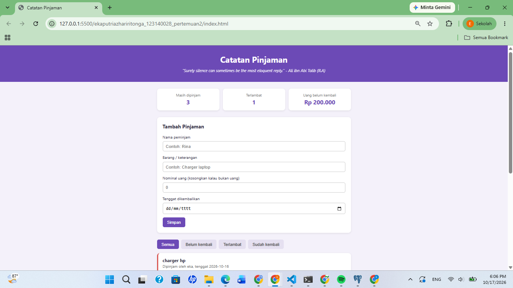
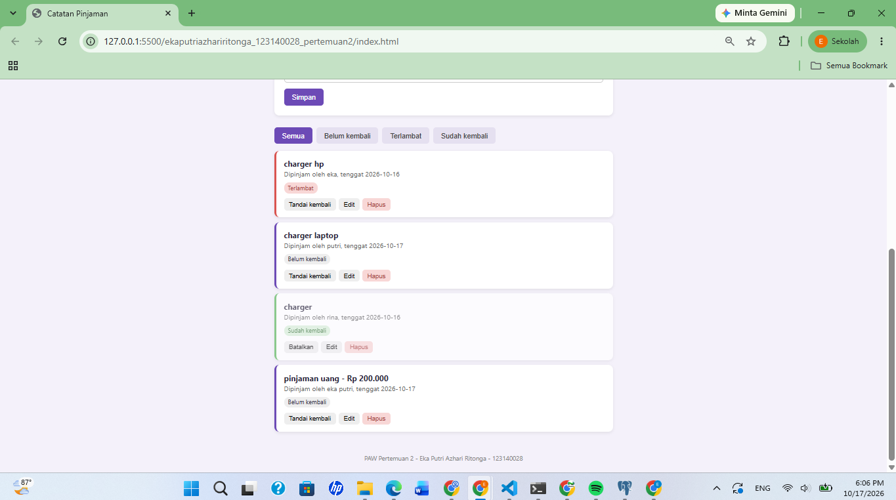

# Catatan Pinjaman

Aplikasi personal dashboard untuk mencatat barang dan uang yang dipinjam orang lain, supaya tidak lupa siapa yang belum mengembalikan. Dibuat untuk tugas Praktikum PAW Pertemuan 2.

## Fitur
- Tambah, edit, dan hapus data pinjaman
- Tandai pinjaman sudah kembali atau batalkan
- Status otomatis: belum kembali, terlambat (tenggat lewat), sudah kembali
- Filter daftar berdasarkan status
- Ringkasan jumlah pinjaman aktif, jumlah terlambat, dan total uang yang belum kembali
- Data tersimpan di localStorage sehingga tidak hilang saat halaman di-refresh
- Kutipan harian dari API publik DummyJSON di bagian header

## Screenshot

## Fitur ES6+ yang Digunakan
| Fitur | Lokasi (`script.js`) |
|---|---|
| `const` | baris 14, 24, 37, 47, 60-62, 77-78, 114-116 |
| `let` | baris 48 |
| Arrow function | baris 38, 60-62, 70, 84, 118, 123, 126-127, 136 |
| Template literals | baris 52, 66, 81, 86, 93-105 |
| Async/await dan fetch | baris 46-56 |
| Class (`TaskItem`, `DashboardApp`) | baris 2-22 dan 27-205 |
| Destructuring | baris 3, 51, 85, 137, 170 |
| Getter di class | baris 13, 18 |
| `map`, `filter`, `reduce` | baris 38, 60-62, 70, 84, 201 |
| Nullish coalescing (`??`) | baris 4 |

## Cara Menjalankan
Buka `index.html` di browser (bisa pakai Live Server di VS Code).