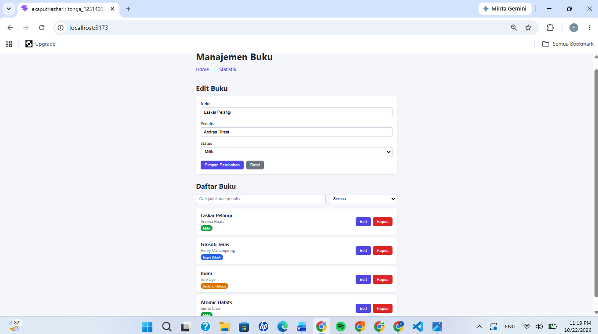
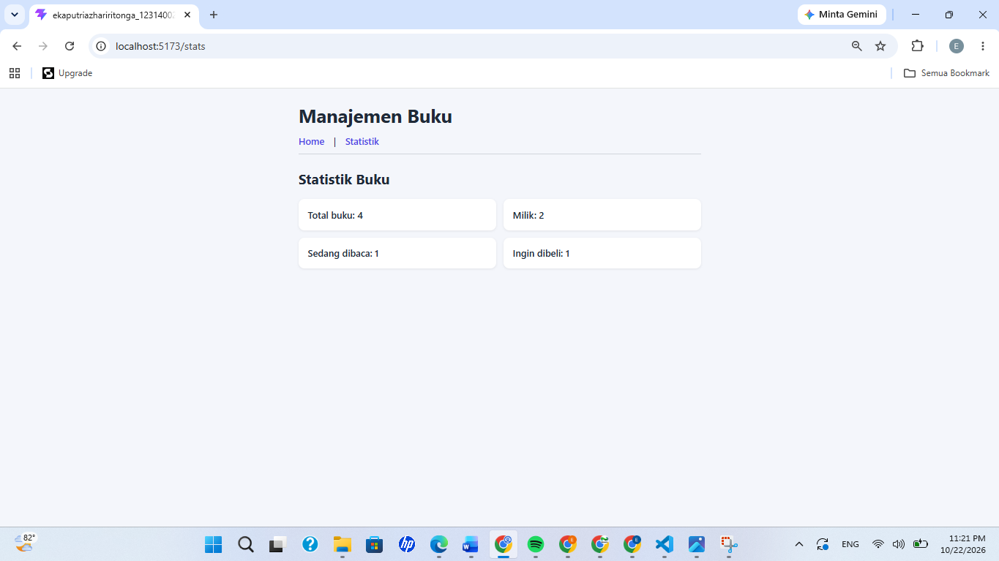
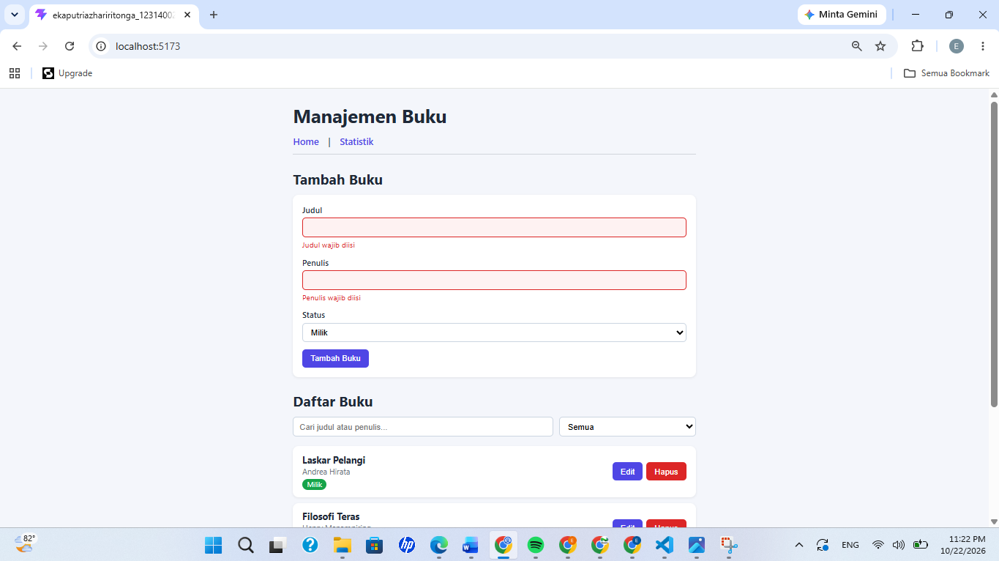
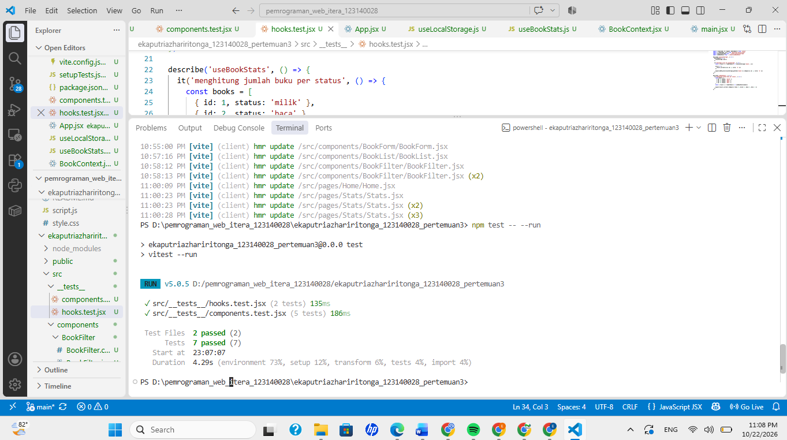

# Manajemen Buku Pribadi

Aplikasi web untuk mencatat buku yang dimiliki, sedang dibaca, atau ingin dibeli. Dibuat dengan React + Vite sebagai tugas Praktikum PAW Pertemuan 3.

## Fitur

- Tambah, edit, dan hapus buku (judul, penulis, status: milik / baca / beli)
- Filter buku berdasarkan status
- Pencarian berdasarkan judul atau nama penulis
- Halaman statistik jumlah buku per status
- Validasi form (kolom wajib diisi + feedback visual)
- Data tersimpan di localStorage (tetap ada setelah refresh)

## Instalasi dan Cara Menjalankan

```bash
npm install
npm run dev
```

Buka http://localhost:5173

Menjalankan unit test:

```bash
npm test -- --run
```

## Screenshot

### Halaman Home


### Halaman Statistik


### Validasi Form


### Hasil Unit Test


## Fitur React yang Digunakan

- **useState**: state form, filter, pencarian, dan buku yang sedang diedit
- **useEffect**: sinkronisasi data ke localStorage dan reset form saat mode edit berubah
- **Komponen reusable**: `BookForm`, `BookList`, `BookFilter`
- **Context API**: `BookContext` menyimpan data buku dan fungsi `addBook`, `updateBook`, `deleteBook`
- **React Router**: navigasi halaman Home (`/`) dan Statistik (`/stats`)
- **Custom hooks**: `useLocalStorage` (persistensi data) dan `useBookStats` (hitung statistik)
- **PropTypes**: type checking pada seluruh komponen
- **Testing**: Vitest + React Testing Library (7 test)

## Struktur Folder

```
src/
├── components/
│   ├── BookForm/
│   ├── BookList/
│   └── BookFilter/
├── pages/
│   ├── Home/
│   └── Stats/
├── hooks/
│   ├── useLocalStorage.js
│   └── useBookStats.js
├── context/
│   └── BookContext.jsx
├── __tests__/
└── App.jsx
```