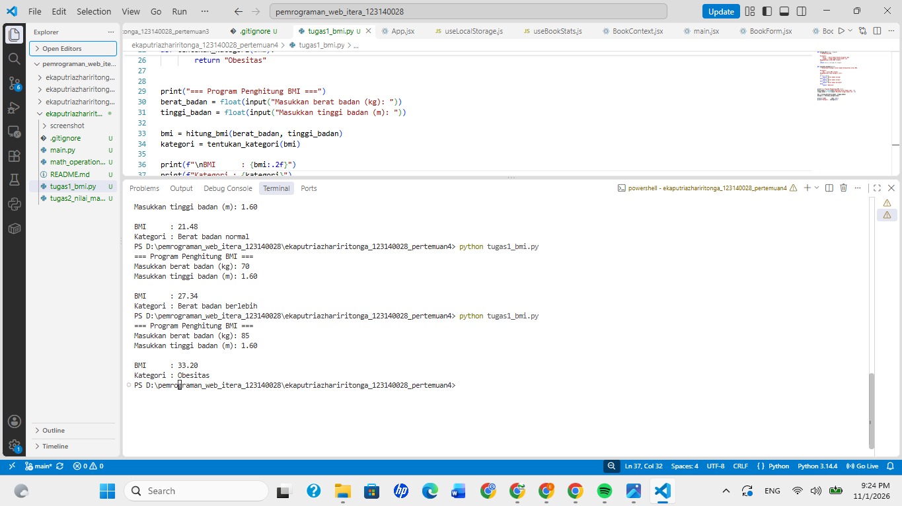
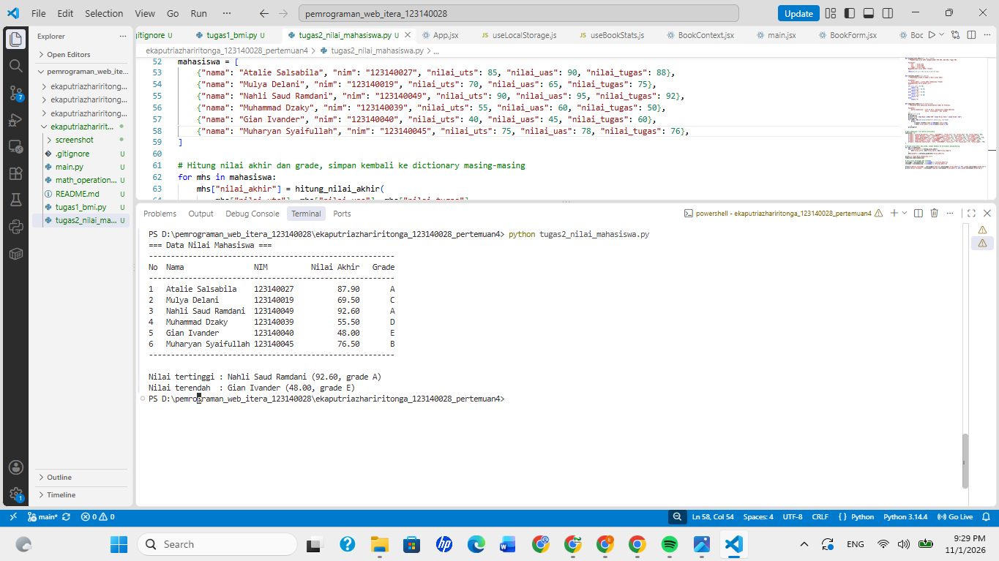
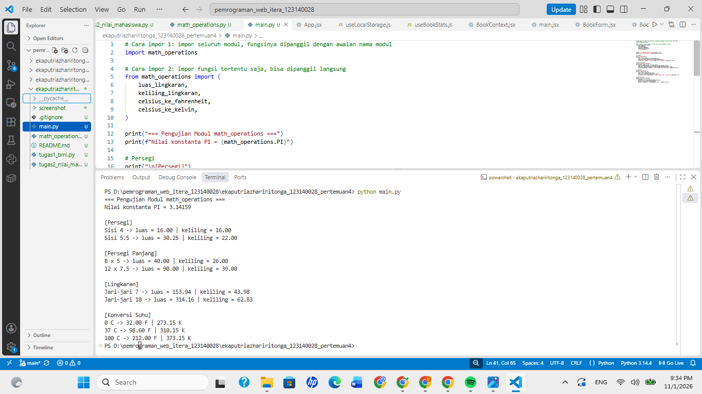

# Tugas Praktikum Pertemuan 4 - Python Dasar

**Nama:** Eka Putri Azhari Ritonga
**NIM:** 123140028
**Kelas:** RA

## Deskripsi Program

### Tugas 1: Penghitung BMI (`tugas1_bmi.py`)
Program meminta input berat badan (kg) dan tinggi badan (meter), lalu menghitung BMI dengan rumus `berat / (tinggi * tinggi)`. Kategori ditentukan dengan `if-elif-else` (berat badan kurang, normal, berlebih, atau obesitas). Hasil BMI ditampilkan dengan 2 angka desimal.

### Tugas 2: Pengelolaan Data Nilai Mahasiswa (`tugas2_nilai_mahasiswa.py`)
Data enam mahasiswa disimpan dalam list berisi dictionary (nama, NIM, nilai UTS, UAS, dan tugas). Nilai akhir dihitung dengan bobot 30% UTS, 40% UAS, dan 30% tugas, lalu grade A sampai E ditentukan dari nilai akhir. Seluruh data ditampilkan dalam bentuk tabel, diikuti mahasiswa dengan nilai akhir tertinggi dan terendah.

### Tugas 3: Modul Matematika (`math_operations.py` dan `main.py`)
`math_operations.py` berisi konstanta `PI`, fungsi luas dan keliling (persegi, persegi panjang, lingkaran), serta konversi suhu Celsius ke Fahrenheit dan Kelvin. `main.py` mengimpor modul tersebut dengan dua cara (`import math_operations` dan `from math_operations import ...`), memanggil seluruh fungsinya dengan beberapa nilai uji, lalu menampilkan hasilnya.

## Cara Menjalankan

Pastikan Python sudah terpasang, lalu buka terminal di folder ini dan jalankan:

```bash
python tugas1_bmi.py
python tugas2_nilai_mahasiswa.py
python main.py
```

Pada Tugas 1, masukkan tinggi badan dalam satuan meter dengan titik sebagai pemisah desimal (contoh: `1.60`).

## Screenshot Hasil 

### Tugas 1


### Tugas 2


### Tugas 3
