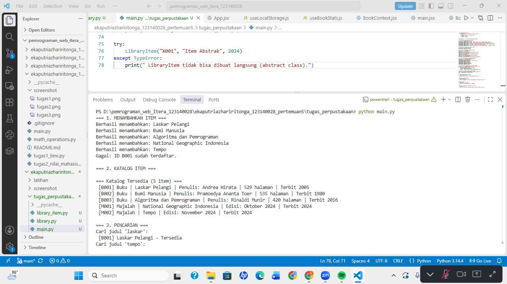
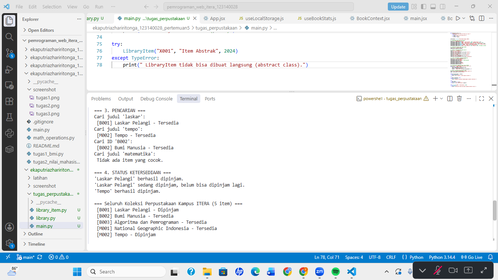
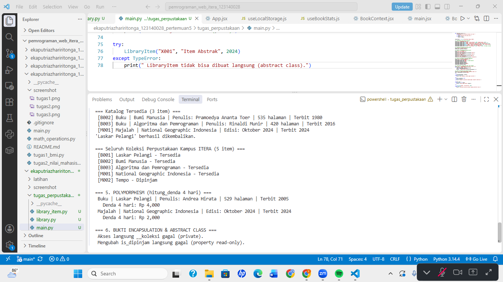
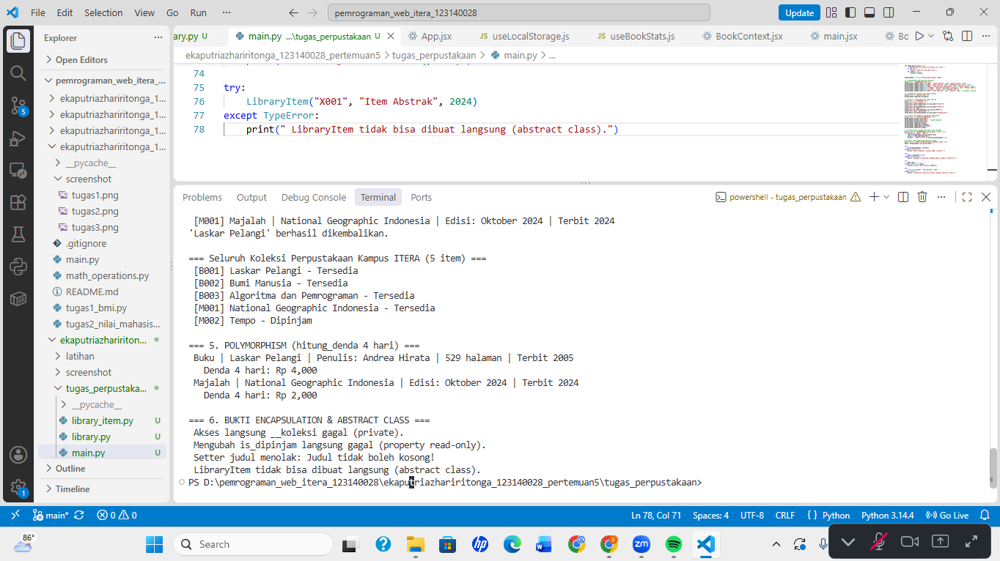

# Tugas Praktikum Pertemuan 5 - Python OOP

## Identitas Mahasiswa
- **Nama:** Eka Putri Azhari Ritonga
- **NIM:** 123140028
- **Kelas Praktikum:** RA

## Deskripsi Program
Sistem manajemen perpustakaan sederhana berbasis OOP Python. Program dapat menambahkan item (buku dan majalah) ke perpustakaan, menampilkan katalog item yang tersedia, mencari item berdasarkan judul atau ID, serta menunjukkan status ketersediaan item saat dipinjam dan dikembalikan.

Alur program: `main.py` membuat objek `Library`, menambahkan beberapa `Book` dan `Magazine`, lalu menjalankan pencarian, peminjaman, dan pengembalian. Bagian akhir `main.py` mendemonstrasikan keempat pilar OOP lewat contoh yang sengaja dibuat gagal.

### Struktur Berkas
- `library_item.py`: abstract class `LibraryItem` beserta subclass `Book` dan `Magazine`
- `library.py`: class `Library` untuk mengelola koleksi item
- `main.py`: skrip untuk menguji seluruh fungsionalitas

### Penerapan Pilar OOP
- **Class dan Object:** `LibraryItem`, `Book`, `Magazine`, dan `Library` adalah class. Objek dibuat di `main.py`, misalnya `Book("B001", "Laskar Pelangi", ...)`.
- **Inheritance:** `Book` dan `Magazine` mewarisi `LibraryItem` dan memakai `super().__init__()` untuk meneruskan data umum (ID, judul, tahun terbit).
- **Abstract Class:** `LibraryItem(ABC)` memiliki dua method abstract, `get_detail()` dan `hitung_denda()`. Objek `LibraryItem` tidak bisa dibuat langsung, dan setiap subclass wajib mengisi kedua method tersebut.
- **Encapsulation:**
  - `_item_id` dan `_tahun_terbit` bersifat protected (satu garis bawah).
  - `__dipinjam` di `LibraryItem` dan `__koleksi` di `Library` bersifat private (dua garis bawah), hanya bisa diubah lewat method milik class.
  - `@property` dipakai pada `item_id` dan `is_dipinjam` (hanya bisa dibaca) serta `judul` (dengan setter yang menolak judul kosong).
- **Polymorphism:** `Book` dan `Magazine` memiliki versi `get_detail()` dan `hitung_denda()` masing-masing. Denda buku Rp 1.000 per hari, majalah Rp 500 per hari. Method dipanggil dengan cara yang sama tanpa memeriksa jenis itemnya.

## Panduan Menjalankan Program
Pastikan Python 3 sudah terpasang. Buka terminal di folder `tugas_perpustakaan`, lalu jalankan:

```bash
cd tugas_perpustakaan
python main.py
```

## Screenshot Output
Output program `main.py` dibagi menjadi empat tangkapan layar sesuai urutan eksekusi:









Output mencakup penambahan item, katalog item tersedia, pencarian berdasarkan judul dan ID, status ketersediaan saat dipinjam dan dikembalikan, demonstrasi polymorphism, serta bukti encapsulation dan abstract class.

## Latihan
Folder `latihan/` berisi kode hands-on dari modul Pertemuan 5 (class dan object, inheritance, encapsulation, polymorphism, dan abstract class).